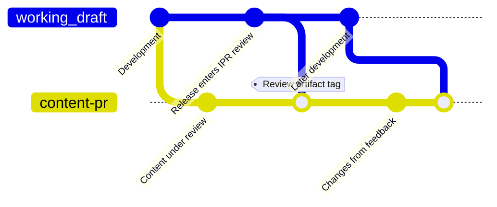

# FOCUS Review Artifact Guidelines

## Overview

A review artifact is a PDF build of the FOCUS Specification that includes content held back from a release, so people can give feedback on it. The content it adds or changes is under review, and the sections that hold that content are its sections under review. The rest, apart from its Version, Status of This Document, and Table of Contents, matches the release it goes out with. It is not a FOCUS release, it is not for production use or conformance claims, and it has no requirements model (the machine-readable form of the specification's rules).

Data generators, which produce FOCUS data, and practitioners, who use it, are asked what it would take to generate or use the data it describes. Trying the content out is welcome. What they learn helps settle the open questions that keep the content out of a release.

Its Markdown source stays in GitHub. Its tracking issue, a GitHub issue, records its open questions and every decision, and holds the checklist for building and sharing it.

Where a review artifact sits in the specification lifecycle belongs in the [FOCUS Operating Procedures](https://github.com/FinOps-Open-Cost-and-Usage-Spec/foundation/blob/main/operating_procedures.md). This guideline covers how one is approved, built, shared, and retired.

### Roles

Members, Maintainers, and Support Staff are defined in section 2.2 of the [FOCUS Operating Procedures](https://github.com/FinOps-Open-Cost-and-Usage-Spec/foundation/blob/main/operating_procedures.md#22-organization-roles), and Admins in section 6.1.

* **Members:** FOCUS Group Contributors (section 2.2.1). Decisions at the weekly Members meeting follow the Review & Approval process (section 5.2).
* **Maintainers:** FOCUS Group Maintainers (section 2.2.4), listed in [MAINTAINERS.md](../MAINTAINERS.md).
* **Task Force:** a group of Members that develops related content, led by a Task Force Convener (section 2.2.3).
* **Pull request authors:** the Members who opened the pull requests that hold the content under review.
* **Admins:** FOCUS Admins (section 6.1), who merge pull requests.
* **Support Staff:** FOCUS Group Support Staff (section 2.2.6), the FinOps Foundation team that supports FOCUS.

### Lifecycle

| Stage | Who | What happens |
| --- | --- | --- |
| 1. Approve | Members meeting | Approve the content and its open questions |
| 2. Build | Pull request authors, Admins | Combine the content into one pull request, tag one commit, and build the PDF |
| 3. Share and review | Admins, Support Staff | Share the PDF after its release's Intellectual Property Rights (IPR) review and after the review artifact completes the steps the FOCUS Operating Procedures require for it, and collect feedback |
| 4. Retire | Task Force, with retirement agreed at the Members meeting | Check progress each release, report it at the Members meeting, and retire the review artifact when the Members meeting agrees |

## Stage 1: Approve

A review artifact is approved the same way as a pull request (see [Development Processes](contributors/development-processes.md#pull-request-approval-and-conflict-resolution)). Its pull requests need their GitHub approvals and resolved comments, and then it is approved at the Members meeting, through the Review & Approval process, after two presentation cycles. Supported features, the parts of the specification that show how FOCUS data meets common FinOps needs, are part of the content under review.

A review artifact MUST adhere to the following requirements:

* A review artifact MUST be approved at the Members meeting before it is built.
* When the content under review has supported features, a review artifact MUST include them.
* A review artifact MUST have a tracking issue.

## Stage 2: Build

The content under review stays on its pull request, which targets `working_draft`. When the content spans more than one pull request, the others merge into it first. From approval until the tag, the pull request changes only through those merges and by merging in `working_draft`. When the release that the review artifact goes out with enters its IPR review, the pull request authors merge `working_draft`, at the commit that review starts from, into the pull request and resolve any conflicts. When a resolution changes the content under review, the review artifact goes back to the Members meeting before it is built. Admins then tag the result and build the PDF from the tag. The pull request stays open after the tag, while the PDF stays fixed.

A review artifact MUST adhere to the following requirements:

* A review artifact MUST be built from its content as it stood at a single point in time, marked by one tagged commit.
* The tagged commit of a review artifact MUST be in the `FOCUS_Spec` repository.
* A review artifact MUST NOT be revised after it is built.
* The content under review in a review artifact MUST match the approved content.
* The text of a review artifact outside the content under review, except its Version, Status of This Document, and Table of Contents, MUST match the text of the release it goes out with, as that release enters its IPR review.
* Links in a review artifact to files in the repository MUST resolve to its tagged commit.
* Every page of a review artifact MUST show a "Review Artifact" watermark.
* A review artifact MUST open with the following statements:
  * It is not a FOCUS release, and it is not for production use or conformance claims.
  * Trying the content out is welcome.
  * Which sections are under review.
  * Where its tracking issue is.

## Stage 3: Share and Review

A review artifact is shared only after the release it goes out with completes its IPR review, a patent review period. How the review artifact itself is cleared for IPR, and what approval it needs after its own IPR review, belong in the FOCUS Operating Procedures. Sharing means sending the PDF, or a link to it, to people for feedback. Support Staff collect the feedback. Work on the content continues through the normal development process: its pull request stays open against `working_draft`, and changes based on feedback go into it.

A review artifact MUST adhere to the following requirements:

* A review artifact MUST NOT be shared before the Steering Committee ratifies the addition of review artifacts to the FOCUS Operating Procedures.
* A review artifact MUST NOT be shared before the IPR review of the release it goes out with is complete.
* A review artifact MUST NOT be shared before it completes every review, final approval, and ratification step that the FOCUS Operating Procedures require for it.
* Files from a review artifact build other than the PDF (e.g., `spec.html` or `spec.md`) MUST NOT be shared.
* A review artifact MUST NOT be announced as part of a release.
* Any announcement or message that shares a review artifact MUST state that its content, including any sample data, is out for review.
* The content under review MUST NOT be part of the release that the review artifact goes out with.
* The content under review SHOULD NOT be proposed for a release until the review artifact is retired.

## Stage 4: Retire

A review artifact has no time limit, since content can need more than one release to mature. The Task Force that owns the content checks its progress at least once per release and reports each decision at the Members meeting. After retirement, the content is closed, continues under a new review artifact, or moves toward a release through a pull request approved at the Members meeting.

A review artifact MUST adhere to the following requirements:

* A review artifact MUST have its progress checked at least once per release.
* Each progress check decision for a review artifact MUST be reported at the Members meeting.
* Each progress check of a review artifact MUST end in a decision to continue it or to ask the Members meeting to retire it.
* A review artifact MUST NOT be retired when the passage of time is the only reason for retirement.
* A review artifact MUST NOT be retired unless the Members meeting agrees on one of the following:
  * The tracking issue's questions are answered.
  * The content should move toward a release while a question is still open.
  * The content should be closed.
  * A new review artifact for the content is shared.
  * The review artifact is no longer useful.
* A retired review artifact MUST NOT be shared, apart from the copy its tracking issue keeps as a record.

## Tracking Issue

The Task Force records each progress check decision on the tracking issue, including the retirement once the Members meeting agrees to it. The tracking issue also holds the PDF, so a record of what was reviewed stays after retirement.

A review artifact MUST adhere to the following requirements:

* The tracking issue of a review artifact MUST list the following, as approved at the Members meeting:
  * The questions the review needs to answer.
  * The pull requests that hold the content under review.
  * The sections under review.
* The tracking issue of a review artifact MUST record the following:
  * The Git tag and the commit that the review artifact is built from.
  * The decision from each progress check.
  * The date of the next progress check, unless the review artifact is retired.
* The tracking issue of a review artifact MUST NOT hold its PDF before the review artifact can be shared under Stage 3.
* The tracking issue of a review artifact MUST hold its PDF from the time the review artifact is first shared, including after it is retired.
* The tracking issue of a review artifact SHOULD summarize the feedback on it.
* When a review artifact is retired, the top of its tracking issue's description MUST say so and give the reason.
